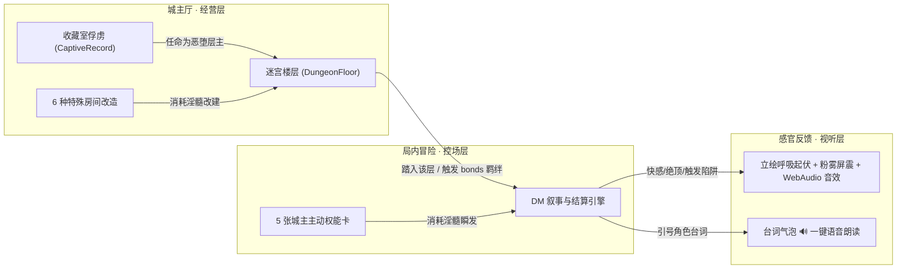

# 地下城城主 · 第四阶段三大核心系统升级计划

本计划围绕选定的 **1（恶堕眷属驻防与羁绊连锁）**、**3（深渊房间改造与城主主动权能卡）**、**5（视听反馈：台词 TTS 语音 + 动态立绘微交互 + 音效）** 三大模块展开，在不破坏现有存档结构与自动化测试的前提下，打通「多周目收集 → 驻防经营 → 局内控场 → 视听沉浸」的完整体验。

---

## 模块一：俘虏「恶堕层主 / 眷属副官驻防」与羁绊连锁

> 现有存档中 `CaptiveRecord` 仅有轻量的 `lureFloor`（被动肉饵展示）。本模块将其升级为可主动参战、会触发 `bonds` 宿命破防台词、并能参与双人场景生图的**「恶堕层主（Fallen Warden）」**机制。

### 1. 数据与机制设计（`lib/keeper.ts` / `lib/synergy.ts`）
- **驻防职责（`wardenRole`）**：在 `CaptiveRecord` 上新增可选字段 `wardenFloor?: number`（每层限任命 1 名层主）与 `wardenRole?: 'temptress' | 'enforcer' | 'livestock'`（向下兼容旧 `lureFloor`，自动迁移为 `'livestock'`）：
  - **惑心助教（`temptress`）**：每当闯入者在该层行动时，额外附加 **欲望 +8**，并在 DM 叙事中主动出面贴耳劝诱、示范侍奉城主。
  - **拘束副官（`enforcer`）**：该层陷阱/魔物命中率提升（等效命中分 **+1**），闯入者挣脱拘束难度增加（初次拘束层数保底 `restraint >= 2`），叙事中由她亲手按住闯入者四肢或封住退路。
  - **产乳苗床（`livestock`）**：沿用并强化肉饵展示，闯入者目睹其沉沦姿态动摇心神（快感抗性下降），同时每回合额外产髓 **+3 淫髓**（若该俘虏具备泌乳体质则 **+5 淫髓**）。
- **宿命羁绊暴击（`bonds` 连锁）**：
  - 当闯入者的 `bonds` 列表中包含该层驻防层主（例如**高雄**踏入**爱宕**驻守的楼层、**大凤**撞见**赤城**、讨伐队同伴重逢）时，自动激活**「羁绊恶堕冲击」**：
    1. 首回合立即触发专属动摇结算（欲望 **+15**、快感 **+10**），状态栏记入变化日志 `目睹「XX」恶堕驻防`。
    2. 将 `bond.captiveLine` 与驻防层主的人设口癖、当前崩坏态称呼一并注入本层 DM 系统提示词，要求写出熟人当面劝降与羞耻感加倍的对手戏。
- **场景生图联动（`lib/prompts.ts`）**：
  - 当本层有恶堕层主在场且 `[SCENE]` 涉及两人互动时，自动拼接驻防层主的核心外貌锚点（`2girls` + 双方发色/瞳色/胸围特征），支持直接画出恶堕前辈调教新人的双人 CG。

### 2. UI 交互改动
- **`components/keeper-collection.tsx`**：每张俘虏卡底部将原有的单一「派驻肉饵」升级为**「任命层主（选择楼层 + 三种职责切换）」**胶囊组。
- **`components/keep-hall.tsx` & `components/status-panel.tsx`**：楼层卡片与左侧「生效中的布置」列表显示驻守该层的恶堕层主小头像、职责徽章，以及是否与当前闯入者存在 `⚡宿命羁绊` 高亮提示。

---

## 模块二：深渊基建「6 种专属房间改造」与「5 张城主主动权能卡」

### 1. 楼层专属房间改造（`lib/keeper.ts` / `components/keep-hall.tsx`）
在 `DungeonFloor` 新增 `roomMod?: RoomModId`，消耗淫髓即可将普通石室永久改建为特色调教房（可随时付费改建切换），同时影响 **数值结算 + 叙事环境描写 + 生图背景 Tag**：

| 房间改造 ID | 名称 | 造价 | 局内数值规则（每回合生效） | 叙事与生图环境锚点 |
| :--- | :--- | :---: | :--- | :--- |
| `aphro_conservatory` | **催情香雾温室** | 18 髓 | 每回合固定 **欲望 +8**；含 `aphro` 弱点角色额外 **快感 +6** | 粉雾弥漫、甜腻催情花粉（`pink fog, glowing pollen, conservatory`） |
| `milking_pasture` | **深渊榨乳牧场** | 22 髓 | 胸部开发经验获取 **×1.5**；泌乳角色或胸部 ≥Lv.3 每回合额外产出 **+4 淫髓** | 榨乳管线、白浊滴落（`milking machine, pasture stall, dripping milk`） |
| `mirror_gallery` | **公开羞辱镜厅** | 20 髓 | 破衣判定加速；处于 `shaken` 及以上时每回合额外 **欲望 +6、快感 +5** | 四面落地魔镜、无死角倒影（`mirror room, reflections, crystal chandelier`） |
| `tentacle_nursery` | **活体肉壁苗床** | 24 髓 | 本层 `tentacle / parasite` 陷阱与魔物命中强化，挣脱进度减半 | 蠕动肉壁、粘液菌毯（`fleshy walls, slime floor, organic tentacles`） |
| `hypno_sanctum` | **常识改写圣堂** | 26 髓 | 堕落度达到 `动摇` 后，回合结算自动额外推进称呼松动，抑制生命值扣减转为快感 | 催眠魔纹阵、紫粉烛火（`glowing magic circle, hypnotic light, dark altar`） |
| `sensory_prison` | **感官剥夺暗牢** | 22 髓 | 遮蔽视线与听觉，首次受击快感倍率 **×1.35**，阴蒂/尿道/后庭开发经验 **+50%** | 漆黑铁牢、束缚吊链（`dark dungeon, hanging chains, blindfold`） |

### 2. 城主主动权能卡（`lib/keeper-powers.ts` / `components/chat-panel.tsx`）
在冒险对话输入框上方提供可折叠的**「👑 城主权能」**快捷栏，消耗当前库存淫髓即可直接作为本回合特殊指令发出：
1. **感官倍增（8 淫髓）**：本回合快感增量 **×1.6**，强制描写神经敏感度暴涨。
2. **衣甲崩解（10 淫髓）**：立刻震碎一层护甲/外衣，同步写入服装损毁记忆并触发裸露羞耻反应。
3. **催眠暗示（12 淫髓）**：扭曲认知一回合（如把眼前魔物/触手错认成指挥官/制作人或温柔抚触），大幅压低抵抗烈度。
4. **淫纹共鸣引爆（15 淫髓，需已刻淫纹或快感 ≥60）**：瞬间引爆体内魔力，直接拉升快感至临近绝顶（**+25 快感**）并强制漏出失态台词。
5. **时间凝滞玩弄（18 淫髓）**：本回合闯入者无法推进探索度或挣脱拘束，任由城主在静止时间中堆叠多部位开发经验，解冻瞬间一次性爆发结算。

---

## 模块三：视听沉浸升级（立绘微交互 + Web Audio 音效 + 台词 TTS）

> 所有音效与语音均提供**顶部一键静音开关**与设置面板细项控制，其中环境/触发音效采用浏览器原生 **Web Audio API 程序化合成**（零外部音频资源体积），TTS 支持**免配置神经语音合成 / 浏览器本地语音 / 自定义外部 TTS API（Fish Audio / ElevenLabs / GPT-SoVITS）**三级模式。

### 1. 左侧动态立绘微交互与绝顶视觉反馈（`components/status-panel.tsx` / `app/globals.css`）
- **呼吸律动**：为立绘增加柔和 CSS 呼吸缩放与浮动动画（`pure` 平缓呼吸 → `fallen / broken` 急促起伏）。
- **发情粉雾暗角**：当 `pleasure >= 70` 时，立绘边框与底部浮现心跳节律的粉紫柔光粒子暗角。
- **绝顶与陷阱触发瞬态反馈**：当本回合结算跨越 `pleasure >= 95`（绝顶）或新撞上陷阱/刻下烙印时，触发一次克制的**粉白闪光脉冲 + 0.35s 轻微屏震动效**（遵循 `prefers-reduced-motion` 无障碍降级）。

### 2. 原生 Web Audio 氛围与事件音效引擎（新建 `lib/sound-fx.ts`）
使用原生 `AudioContext` 合成细腻低打扰的交互声效（默认开启低音量，可在顶栏一键静音）：
- **机关/锁链触发声**：撞入陷阱或拘束加深时的低沉金属锁扣声。
- **魅惑心跳脉冲**：快感突破 80 或发动「淫纹引爆」时的双拍低频心跳声。
- **淫髓入账清脆晶音**：收获淫髓、建造房间或魔物变异时的魔晶共鸣声。

### 3. 角色引号台词 `🔊` 一键语音朗读（`components/reply-markdown.tsx` + 新建 `app/api/tts/route.ts`）
- **UI 交互**：在 `components/reply-markdown.tsx` 已识别出的角色引号台词（`「……」`）末尾悬浮/常驻一枚精致小巧的 `🔊` 播放图标；点击即可朗读该句台词（支持开启「新回合自动朗读首句台词」开关）。
- **声线智能匹配**：根据角色人设（如娜露梅亚/嘉列翁→温柔御姐声线、信浓→慵懒低柔声线、志希/柴郡→俏皮元气声线、鹭泽文香→轻细弱气声线）自动映射语速、音高与预设音色 ID。
- **多后端支持（`components/settings-panel.tsx` 新增「语音与音效」设置区）**：
  1. **开箱即用模式（默认无需额外 Key）**：服务端 `/api/tts` 在线神经女声合成（若离线则无缝降级至浏览器 `speechSynthesis`）。
  2. **高阶自定义 API 模式**：支持填入 **Fish Audio / OpenAI-Compatible TTS / 本地 GPT-SoVITS** 地址与 Key。

---

## 验证与测试计划
1. **自动化单元测试扩展**：
   - 在 `scripts/check-dungeon.cjs` 与 `scripts/check-keeper.cjs` 中新增：**恶堕层主驻防产髓与命中加成测试**、**`bonds` 宿命重逢数值与提示词注入测试**、**6 种房间改造与 5 张城主权能卡扣费及结算测试**、旧存档兼容迁移测试。
   - 运行完整校验链：`NODE_OPTIONS=--experimental-global-webcrypto npm run test:adventure && ./node_modules/.bin/tsc --noEmit --incremental false`。
2. **真实浏览器实机验收**：
   - 在 `http://localhost:3001` 验证：任命俘虏为层主 → 改建特殊房间 → 放入羁绊角色闯关 → 局内释放城主权能卡 → 检验立绘呼吸/高潮特效、音效开关与台词点击语音播放。
